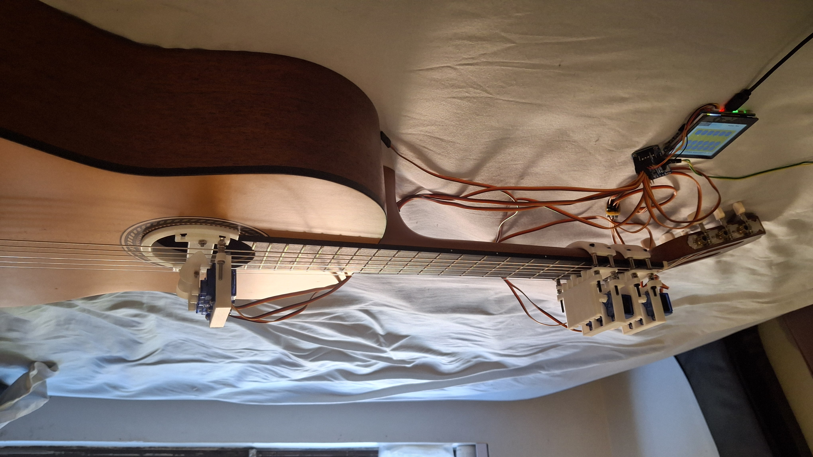

# GuitarBot

## Overview
Guitarbot is an open source, 3D printed guitar playing robot that can jam with you and learn songs.

.jpg)

## Get Started

### Prerequisites
*   ESP-IDF (version >=6.1): [Visit Espressif ESP-IDF Get Started](https://docs.espressif.com/projects/esp-idf/en/stable/esp32/get-started/index.html)
*   Waveshare ESP32-S3-Touch-LCD-2.8 (or similar): [Visit Waveshare Wiki](https://docs.waveshare.com/ESP32-S3-Touch-LCD-2.8) 
*   3D printer: (any of your choosing)
*   3D slicing software: any, for example [Visit Cura](https://ultimaker.com/software/ultimaker-cura/)

### Materials
| Component | Quantity | Link |
| --- | :---: | --- |
| ESP32-S3-Touch-LCD-2.8 | 1 | [Wiki](https://docs.waveshare.com/ESP32-S3-Touch-LCD-2.8) |
| SG90 Servos | >= 6 | [Amazon](https://www.amazon.com.au/Micro-Airplane-Aeroplane-helcopter-Helicopter/dp/B07Z3KRYYX) |
| adafruit PCA9685 breakout | 1 | [Adafruit](https://www.adafruit.com/product/815?srsltid=AU7gw4UMKAmc3d88daRzH-9VFbxY4bYznNDTKQXUI1GGfic4B6Zdnjvn) |
| M3x50 bolts + nuts | >= 10 | any hardware store |
| M3x20 bolts + nuts | 2 | any hardware store |
| M2x8 bolts + nuts | 12 | any hardware store |